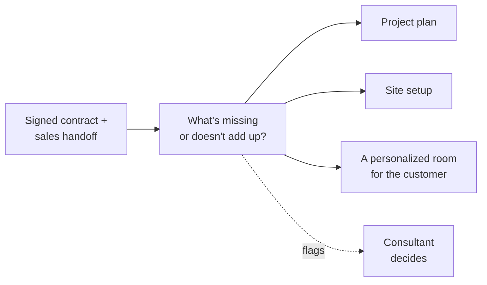

<a href="../README.md">Sonny</a> › Chapter 1 of 9

# 📖 The Full Story

### From support tickets to a much bigger idea.

---

A quick note before we start: I built Sonny while leading Professional Services at a sales enablement software company. I've taken out company, customer and product names. Where something is an estimate or an idea I never built, I say so.

---

## 1. The problem

Most implementations don't go sideways because of the software. They go sideways in the gaps.

Before a kickoff, everything a consultant needed was spread across four documents: the sales handoff, the customer's questionnaire, the contract (the SOW), and a scoping spreadsheet. None of them talked to each other, so the consultant pieced it together in their head.

Here's the one that bugged me most. The contract would say the customer handles content uploads and user setup. The sales handoff would ask, "Does the customer's project owner have time for this?" When the answer was no, the project was in trouble on day one, and nothing in our process caught it. The scoping spreadsheet couldn't either. It told you how many *hours* a project needed, not how *risky* it was.

The day-to-day had the same problem. Meeting notes lived in Zoom, follow-ups in email, decisions in Slack, customer details in a shared doc. A consultant juggling 10–15 customers spent a real chunk of every week just putting the story back together.

And the know-how lived in people. Experienced consultants knew to flag contradictions early and to never let a launch date beat an access problem. Newer folks learned that by shadowing. Once my team grew from 4 to 15 across regions, "just ask Tiffany" stopped working.

---

## 2. Where it started: support tickets

I'll be honest. I built the first piece of Sonny because I didn't love writing support tickets.

But there was a real problem underneath. Our tickets were inconsistent. One would be missing the customer's site details, another the affected users. Support had to come back with questions, and every round trip meant a customer waited longer.

So I built Sonny to read my meeting summaries every morning and draft two things: a recap email for the customer, and a support ticket for anything broken. Every ticket had to include the same four things: who the customer is, what's wrong, what we need and how urgent it is, and who's affected.

A few rules I set from the start:

- **Sonny drafts, I send.** It addressed everything to me, never to a customer.
- **Don't touch the originals.** It never marked my email as read or edited our customer directory.
- **Don't guess.** If a detail was missing, it wrote `[pending]` and told me what to fix.
- **Don't double up.** It checked for an open ticket before drafting a new one.

**What happened:** recaps and tickets went from 30–60 minutes to under 5 per call. And Support pretty much stopped asking follow-up questions. I didn't measure that one, but I definitely noticed.

**What I learned:** the real customer of that first feature was the Support team. Getting it right every time mattered more than getting it done fast.

Once that worked, Sonny took on more of my week:

| What it did | The rule that made it work |
|---|---|
| **Monday digest** of what still needed me | Before flagging something as overdue, check four places to make sure I hadn't already handled it. Nagging me about something I'd already done would've killed my trust in a week. |
| **Team meeting agenda** every Tuesday | Only include updates you can point back to a real email or message. If there's nothing to say, say that. |
| **Weekly status report** on new consultants | Clear rules for green, yellow and red. Onboarding progress stayed something I filled in myself, because I knew things the data didn't. |
| **Back-from-vacation catch-up** | Check everything that was open when I left, drop what's done, and sort the rest by urgency. |

---

## 3. From my assistant to my team's copilot

The automations saved *me* time. But they didn't make anyone else on my team better at the job. The bigger opportunity was the stuff in my head: how to read a contract, prep a call, troubleshoot a problem, or decide a customer is actually ready to launch.

So I wrote it down and gave it to Sonny. The copilot had eight modes a consultant could ask for:

> **Call prep · Contract review · Implementation plan · Product coaching · Troubleshooting · Launch readiness · Customer emails · Practice calls**

Three choices I'm proud of:

1. **I kept "how we work" separate from "how the product works."** Of the seven knowledge files, four were about our method and only three were about specific products. Products change all the time. A good method doesn't. That's what made Sonny something that could travel.

2. **I held Sonny to the same rule I gave my team.** If you're not sure, confirm before you answer. Never make up what a product can do or what a customer bought.

3. **I taught it to protect scope.** When a customer asks for something outside the contract, Sonny names it, suggests how to handle it, and reminds the consultant not to promise anything on the call. That's where services margin gets won or lost.

One line from my playbook ended up mattering more than I expected: *a red/yellow/green status is only useful if you can show the evidence behind it.* That idea is the seed of what I'd build next.

---

## 4. Getting it to the rest of the team

Right before I left, I started piloting Sonny with other consultants. I didn't get to collect results, so I won't pretend I did. But building for other people taught me a few things fast:

- **My automations were wired to me.** My inbox, my channels, my team. You can't just hand someone a copy.
- **Copies drift.** I ended up with two almost-identical versions of the same workflow. Multiply that by fifteen people and you're back to everyone doing it differently, which is the exact problem Sonny was meant to fix.
- **Knowledge goes stale.** Product names and packaging change. Someone has to own keeping it current.
- **Trust takes time.** I trusted Sonny because I'd watched it for weeks. A new consultant hasn't.

The big lesson: **you don't scale a personal tool by copying it. You scale it by pulling out the thinking behind it.** That's why the copilot, not my inbox automations, was the right thing to share first.

**If the whole team had used it** *(an estimate)*: each consultant has 10–15 customers and 1–2 calls with each per week. Using the low end of everything, that's about **4 hours back per person, every week**. The real number could be higher, but I'd rather stand behind the small one.

---

## 5. The bigger idea: Implementation Prep in a Box

*This was on my roadmap. I didn't build it.*

Every new customer started the same way: read the contract, check it against the handoff, build a plan, set up their site, pull together their resources, schedule kickoff. Most of that is repetitive. The part that isn't, spotting what's missing or doesn't add up, is exactly what gets skipped when everyone's busy.

The idea: hand Sonny the signed contract and the sales handoff, and get back everything you need to walk into kickoff confident.

1. **Check it first.** Pull out what the contract actually says, compare it to the handoff, and flag contradictions, gaps and risks *before* building anything.
2. **Build the plan:** milestones, owners and what "done" looks like.
3. **Set up the site.** I'd already automated customer provisioning in an earlier role, which freed up 500+ hours a year. This would save roughly another hour per customer *(an estimate)*.
4. **Give the customer their own room.** Every recap Sonny wrote already pointed customers to their resource center. Why not have Sonny build that page, with their goals, their plan, their recordings and their next steps? The sales process is personalized. Implementation should feel the same way.
5. **Keep the copilot** with the consultant all the way to launch.

**Why checking comes first:** turning a contract into a plan is easy. Noticing the contract quietly doesn't work is the hard part, and the valuable one. A plan built on a contradiction just gets you to the wrong place faster.

I've kept working on this since I left, as a product idea that leads with that check.

---

## 6. What I learned

**Things I'd do again**
- Start with what's broken for someone else, not just what takes the most time.
- Let AI draft and let people decide, for anything a customer sees.
- Only flag things you've double-checked. Being wrong costs more trust than staying quiet.
- Leave a blank instead of guessing.
- Keep the method separate from the product details.
- Leave some things manual on purpose.

**Things I'd do differently**
- **Measure from day one.** I know exactly how much time my recaps saved, and I only have a gut feel for everything else. Next time I'd write down the "before" numbers first.
- **Share the thinking before the tools.** I'd have started teammates on the copilot and made the automations easy to set up for anyone before handing them out.
- **Name an owner for keeping knowledge current**, the day it's written.

**What I'd build next:** just the check, by itself. Not the site setup, not the customer room. It comes first in every project, it works for any product, and you can tell if it's working: did the risks it flagged at kickoff actually show up later?

---

<a href="../README.md">← Back to Sonny</a> &nbsp;·&nbsp; <a href="02-the-problems.md">🧩 The Problems (and the People) →</a>

