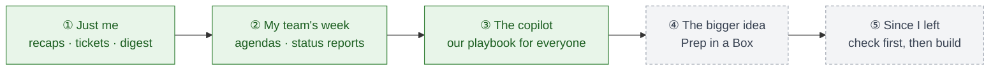

<a href="../README.md">Sonny</a> › Chapter 3 of 9

# 🌱 How Sonny Grew

### What I built, what I piloted, and what stayed on the roadmap.

---

I built Sonny in 2025–2026 while leading Professional Services. The first piece is the one I'm sure about. The order after that is roughly right.

Green: built and used · Grey: designed, not built

---

### ① Just me
**Why:** I didn't love writing support tickets, and incomplete ones kept customers waiting.
**What I built:** a morning helper that turns meeting notes into a recap and a complete ticket, then a Monday list of what's still open.
**What clicked:** the writing was never the hard part. Knowing what was done, what was missing, and what needed me was.

### ② My team's week
**Why:** running a growing global team meant weekly meetings, reports to leadership, and new hires to onboard.
**What I built:** a Tuesday agenda draft, a Friday status report on new consultants, and a one-time catch-up for coming back from vacation.
**What clicked:** every one of these only worked for me. My inbox, my channels, my team.

### ③ The copilot
**Why:** the team grew from 4 to 15, and how well a project went depended on who'd trained whom.
**What I built:** our playbook written down for Sonny, with the method kept separate from the product details, and eight modes consultants could use. I started piloting it right before I left.
**What clicked:** the method could travel. The product details were the part you swap out.

### ④ The bigger idea
**Why:** every new customer started with the same busywork, and the most important step (spotting what doesn't add up) was the one most likely to get skipped.
**What I designed:** hand Sonny the contract and the handoff, and get back the risks, a plan, a set-up site and a personalized room for the customer.

### ⑤ Since I left
I've kept working on it as a product idea that starts with that check. [Here's the plan.](08-whats-next.md)

---

✅ Built and used · 🛠 Piloted (no results collected) · 📐 Planned, not built · 💡 What I'd do now

## What I built

| Piece | Status | What happened |
|---|---|---|
| Meeting recap + support ticket | ✅ | 30–60 min down to under 5 per call; complete tickets |
| Monday digest | ✅ | A double-checked "still open" list every week |
| Team meeting agenda | ✅ | A draft ready every Tuesday |
| New consultant status report | ✅ | A weekly update for my manager |
| Back-from-vacation catch-up | ✅ | Used once |
| The copilot | ✅ | Used in my own prep, contract reviews and launch checks |
| Sharing it with the team | 🛠 | Started right before I left |

## What I'd planned: Prep in a Box

| Piece | Status | Why it mattered |
|---|---|---|
| Read the contract and handoff | 📐 | Catch contradictions and gaps before kickoff |
| Build the project plan | 📐 | Owners and milestones from day one |
| Set up the customer's site | 📐 | About an hour saved per customer *(estimate)* |
| A personalized room for the customer | 📐 | One place for their goals, plan, recordings and next steps |
| The copilot, start to finish | 📐 | The same playbook from kickoff to handoff |

---

<a href="02-the-problems.md">← 🧩 The Problems (and the People)</a> &nbsp;·&nbsp; <a href="04-what-sonny-did.md">🛠️ What Sonny Did →</a>

