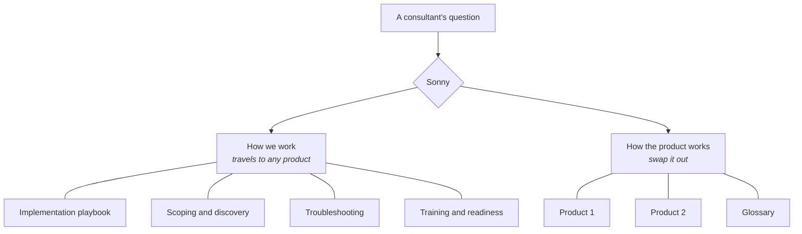

<a href="../README.md">Sonny</a> › Chapter 4 of 9

# 🛠️ What Sonny Did

### Every piece, in plain English, with the rules it followed.

---

A plain-English tour of each piece: what it did, what it looked at, and the rules it followed. The original instructions and knowledge files stay private. Want to see outputs? Check the [examples](05-see-it-in-action.md).

**What it ran on:** Claude, connected to the tools we already used: Gmail, Slack, Google Docs and Sheets, Zoom's meeting summaries, a browser, and our time-tracking system. Some pieces ran on a schedule; the copilot was there whenever someone asked.

---

## For me and my team

### Meeting recap + support ticket · every morning
- **What it did:** turned each new meeting summary into a recap email for the customer, plus a support ticket for anything broken
- **What it looked at:** new meeting summaries, our customer directory, and each customer's open tickets
- **The rules:** drafts only, addressed to me · never mark my email as read or edit the directory · write `[pending]` instead of guessing · every ticket includes who, what's wrong, what we need and how urgent, and who's affected · don't duplicate an open ticket
- **A fun workaround:** the email connection only showed a preview of each message, so Sonny opened the full email in a browser instead of working from half the story
- **Result:** 30–60 minutes down to under 5 per call, and complete tickets every time
- **See it:** [example](05-see-it-in-action.md#meeting-recap--support-ticket)

### Monday digest · via Slack
- **What it did:** recapped last week's meetings, called out wins, and listed what still needed me
- **What it looked at:** meeting summaries, Slack, and my email (including what I'd sent)
- **The rules:** something only counts as "still open" if there's no sign I handled it in Slack, email, a calendar invite, or another meeting · urgent means customer escalations or someone who's followed up twice · ignore newsletters and automatic notifications
- **See it:** [example](05-see-it-in-action.md#monday-digest)

### Team meeting agenda · Tuesdays
- **What it did:** drafted company updates, an ice breaker, a lunch-and-learn idea, and the top three issues from our team tracker
- **The rules:** only include an update you can point back to a real email or message · if a section's empty, say so instead of filling space · keep it readable in two minutes

### New consultant status report · Fridays
- **What it did:** a weekly update for my manager on how each new consultant was ramping
- **What it looked at:** time tracking and each person's Slack activity
- **The rules:** clear definitions for green, yellow and red · new hires start green · onboarding progress stays something I fill in myself, because I knew things the data didn't

### Back-from-vacation catch-up · one time
- **What it did:** the night before I got back, it checked everything that was open when I left, dropped what was done, and sorted the rest by urgency

---

## The copilot

**What it did:** helped any consultant prep, scope, troubleshoot, launch and hand off a project the same way an experienced teammate would.

**How it was organized:**

**Eight things you could ask it for:**

| Ask for… | You'd get |
|---|---|
| **Call prep** | The goal, who's attending and what they care about, an agenda, questions to ask, what to demo, and a backup plan |
| **Contract review** | What the contract actually says, what's unclear, and what might turn into extra scope ([example](05-see-it-in-action.md#contract-review)) |
| **A project plan** | Milestones, owners and what "done" looks like |
| **Product coaching** | A feature explained in customer-friendly language |
| **Troubleshooting** | A step-by-step way to find the problem, from "who's affected?" to "what does Support need?" |
| **Launch readiness** | Green, yellow or red, with the reasons |
| **Customer emails** | Recaps, action lists, risk notes or handoffs |
| **Practice** | Role-play a customer, a quiz, or feedback on a practice call |

**The rules it followed:**
1. Start with why the customer bought, not a feature tour.
2. Explain what to set up, why, how to test it, and what can go wrong.
3. Launch the simplest version first.
4. Have the customer do it during training, not just watch.
5. Be clear about what's documented versus what's just good practice.
6. Never make up what a product can do, what it costs, or what a customer bought.
7. Call out anything outside the contract.
8. Set things up with reporting and adoption in mind from day one.

---

<a href="03-how-sonny-grew.md">← 🌱 How Sonny Grew</a> &nbsp;·&nbsp; <a href="05-see-it-in-action.md">👀 See It in Action →</a>

