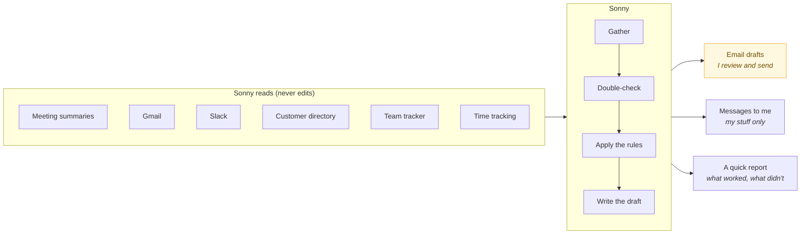
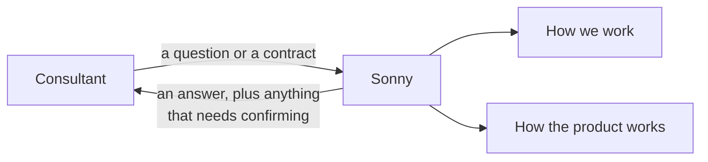

<a href="../README.md">Sonny</a> › Chapter 6 of 9

# 🛡️ Keeping AI in Check

### How I made sure Sonny helped more than it hurt.

---

Sonny read customer emails, team chats and contracts, and it wrote things customers and coworkers would act on. So the question I kept asking wasn't "can AI do this?" It was: **if it gets this wrong, what happens, and who catches it?**

---

## How much Sonny was allowed to do on its own

The further something got from me, the less Sonny could do without a person.

| | Sonny could… | Examples |
|---|---|---|
| **Our tools** | Look, but never change anything | Email, Slack, the customer directory, the team tracker |
| **My own stuff** | Act on its own | A Monday message to me, my own to-do list |
| **Anything for other people** | Draft it, but never send it | Customer recaps, support tickets, agendas, reports |
| **Customer-facing places** | Nothing | Never built, on purpose |

That last line is the most important decision in the whole project. Every draft was addressed to me, and Sonny never filled in a customer's email address.

---

## The rules

| Rule | What it looked like | What could go wrong without it |
|---|---|---|
| **Double-check before flagging** | Only call something "still open" if Slack, email, calendar and other meetings show no sign I'd handled it | Getting nagged about things I'd already done, which kills trust fast |
| **Show your source** | No update unless it came from a real email or message | Updates that sound right but never happened |
| **Don't guess** | Write `[pending]` when something's missing | A wrong customer ID going to Support |
| **Look, don't touch** | Never mark email as read or edit our records | Sonny quietly messing with my inbox or the team's data |
| **Don't double up** | Check for an open ticket before drafting a new one | Duplicate escalations |
| **Say when there's nothing** | Empty sections say "nothing this week" | Filler pretending to be content |
| **Report back** | Every scheduled run told me what it did, what was missing and what failed | Something breaking with nobody noticing |

## The rules for the copilot

The copilot followed the same rule I gave my team: **if you're not sure, confirm before you answer.**

- Never make up what a product can do, what it costs, or what a customer bought.
- Be clear when something might have changed or depends on the customer's setup.
- Call out anything outside the contract instead of quietly agreeing to it.
- Never share one customer's details with another.

---

## What I'd fix before rolling it out to everyone

I'm proud of what I built, but here's what I'd tighten up first:

| What could go wrong | Why it matters | What I'd do |
|---|---|---|
| **Someone sneaks instructions into an email** | Sonny reads emails from people outside the company. A cleverly written email could try to steer what Sonny drafts. | Drafts-only already limits the damage. I'd also treat everything in an email strictly as information, flag anything that looks like an instruction, and never let an email decide who gets a message. |
| **People stop reading drafts** | A person "in the loop" who just clicks send isn't really checking. | Keep drafts short and consistent, track how often people edit them, and spot-check what goes out. |
| **Knowledge goes out of date** | Product names and features change. | Give the knowledge files an owner and date the product details. |
| **No way to measure quality** | I checked every output myself. That doesn't work for fifteen people. | [How I'd measure it](08-whats-next.md#how-id-know-its-working) |
| **Customer information** | Customer conversations go through an AI tool. | Only use company-approved AI tools, and give Sonny only what it needs for each task. |
| **It was set up just for me** | Everything pointed at my inbox and my channels. | Make those settings anyone can change. |

---

## How it was put together

Short version: there was no app, no database and no custom code. Sonny was a set of Claude skills (written instructions) connected to the tools my team already used. Some ran on a schedule; the copilot answered questions whenever someone asked.

That was on purpose. I wanted to find out whether Sonny's judgment was right before building anything bigger around it.

---

### The scheduled helpers

- Everything on the left is look-only. Sonny never changed a source.
- Anything going to a customer or coworker landed as a draft. The yellow box is where a person decides.
- The quick report is how I knew a job had run properly when I wasn't watching.

### The copilot

No automation here, just a really well-prepared teammate. It gave consultants the playbook an experienced colleague would use, and said clearly when a product detail needed double-checking.

---

<a href="05-see-it-in-action.md">← 👀 See It in Action</a> &nbsp;·&nbsp; <a href="07-decisions-along-the-way.md">🧭 Decisions Along the Way →</a>

